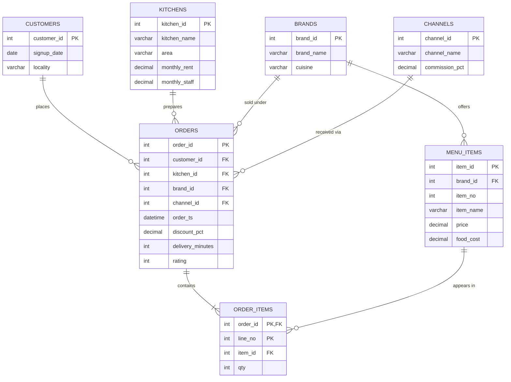

# CloudKitchen Profit & Retention Analytics

  

A pure-SQL analytics project for a Pune-based cloud-kitchen business. It answers one question: **which brands, kitchens, channels and customers actually make money?**

## Table of Contents
1. [Project Overview](#project-overview)
2. [ER Diagram](#er-diagram)
3. [Database Design](#database-design)
4. [Project Structure](#project-structure)
5. [How to Run](#how-to-run)
6. [Business Questions](#business-questions)
7. [Sample Findings](#sample-findings)
8. [SQL Concepts Used](#sql-concepts-used)
9. [Future Improvements](#future-improvements)

## Project Overview
The company runs **5 virtual brands** from **4 kitchens** and sells through **3 channels** (own app, Swiggy, Zomato). Aggregator commissions, discounts, food cost and fixed kitchen costs all eat into profit, so revenue alone is misleading. This project calculates the real contribution margin and studies customer retention using SQL only.

- **Database:** MySQL 8+ (standard SQL)
- **No PL/SQL:** no stored procedures, triggers, cursors or `BEGIN...END` blocks
- **Data:** synthetic and generated with plain SQL (3,000 customers, 15,000 orders, about 28,000 order lines)

## ER Diagram


The same diagram is in `er_diagram.mermaid`; paste it into [mermaid.live](https://mermaid.live) to export a PNG or SVG.

**Relationships**
- One brand offers many menu items.
- One customer, kitchen, brand and channel can each have many orders.
- One order has one or more order lines (`ORDER_ITEMS`); each line refers to one menu item.

## Database Design
| Table | Purpose | Key columns |
|---|---|---|
| `kitchens` | Physical kitchens and fixed monthly costs | `kitchen_id`, `monthly_rent`, `monthly_staff` |
| `brands` | Virtual restaurant brands | `brand_id`, `cuisine` |
| `menu_items` | Items with selling price and food cost | `item_id`, `brand_id`, `price`, `food_cost` |
| `channels` | Sales channels and platform commission % | `channel_id`, `commission_pct` |
| `customers` | Customer master | `customer_id`, `signup_date`, `locality` |
| `orders` | One row per order | `order_id`, foreign keys, `discount_pct`, `delivery_minutes`, `rating` |
| `order_items` | Lines inside each order | `order_id`, `line_no`, `item_id`, `qty` |

**Views**
- `v_order_financials`: gross sales, discount, net sales, food cost and commission per order.
- `v_order_profit`: adds `contribution = net_sales - food_cost - commission`.

## Project Structure
```
cloudkitchen_sql_project/
|-- 01_schema.sql              # tables, keys
|-- 02_seed_data.sql           # reference data + generated customers/orders
|-- 03_views_indexes.sql       # indexes and views
|-- 04_analysis_queries.sql    # 10 business questions
|-- er_diagram.mermaid         # ER diagram source
`-- README.md
```

## How to Run
1. Install MySQL 8 or later (MySQL Workbench is fine).
2. Run the files in order:
```bash
mysql -u root -p < 01_schema.sql
mysql -u root -p < 02_seed_data.sql
mysql -u root -p < 03_views_indexes.sql
mysql -u root -p < 04_analysis_queries.sql
```
3. In Workbench, open each file and click the lightning-bolt Execute button instead.

The seed script uses seeded `RAND()`, so results are repeatable on the same server version and may differ slightly on another.

## Business Questions
| # | Question | Techniques |
|---|---|---|
| 1 | Monthly net sales and month-over-month growth | CTE, `LAG` |
| 2 | Brand P&L: discounts, food cost, commission, contribution | JOIN, aggregation, view |
| 3 | Kitchen operating profit after rent and staff | CTE, CROSS JOIN |
| 4 | True margin per sales channel | JOIN, aggregation |
| 5 | Customer cohort retention | CTE, date functions, conditional counts |
| 6 | RFM customer segments | CTE, `NTILE`, CASE |
| 7 | Peak hours and delivery time vs ratings | `HOUR()`, CASE, NULL handling |
| 8 | Menu engineering (Star / Plowhorse / Puzzle / Dog) | `AVG() OVER`, CASE |
| 9 | Items frequently bought together | self-join |
| 10 | Do first-order discounts create repeat customers? | `ROW_NUMBER`, LEFT JOIN |

## Sample Findings
These come from the generated data, so treat them as demonstration results.
- Own-app orders earn about a **58% margin** versus about **34-35%** on Swiggy and Zomato, because of 24-26% commission.
- **Viman Nagar Base** loses money after fixed costs; it has the highest rent.
- Late deliveries (over 40 minutes) average about **1.6 rating** versus about **3.0** when on time.
- First-order discounts do not improve 30-day repeat rate (about 73% vs 74%).

## SQL Concepts Used
JOINs (inner, left, cross, self), GROUP BY, CTEs, views, indexes, CASE, window functions (`LAG`, `NTILE`, `ROW_NUMBER`, `AVG() OVER`), date and time functions, NULL handling, primary and foreign keys.

## Future Improvements
- Connect the views to Power BI or Python (pandas + `pymysql`) for a dashboard.
- Add a recommendations section: shift volume to the own app, rework low-margin menu items.
- Add a data-quality check script (orphan rows, negative margins).
